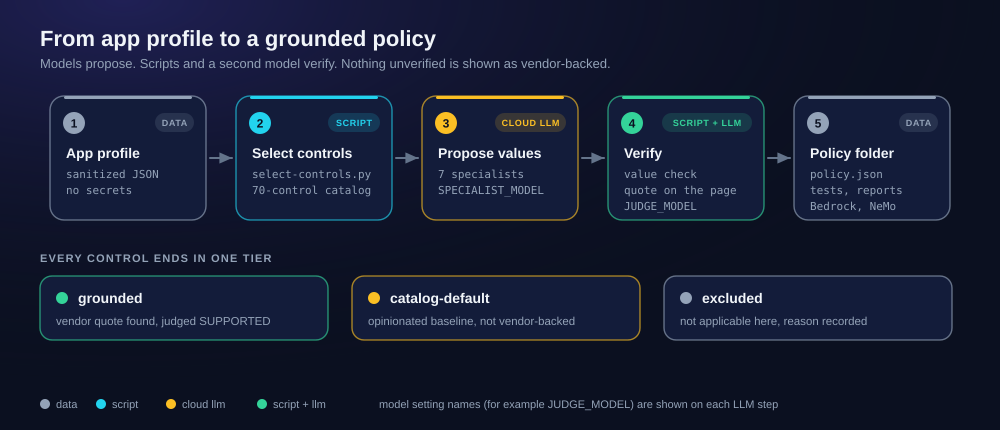

# grounded-ai-guardrails

Draft AI guardrail policies in which every vendor-backed value is tied to a quote from an official page, and answer Prisma Cloud / Cortex Cloud questions with source-cited briefings.

> Independent project. Not affiliated with Palo Alto Networks, Docker, NVIDIA, AWS, OWASP or MITRE. Formerly `docker-agent-prisma-cortex`; old GitHub links redirect here.



## What it is

LLMs write security settings that look plausible but cannot be traced to a source. Here the models only propose. A script checks that each quoted text is on the cited page and that the value fits its type and range. A judge from a different model family then checks that the quote supports the value. Whatever is not verified stays labeled `catalog-default`: an opinionated baseline, not vendor-backed.

## How the pieces relate

| Piece | Role |
|---|---|
| [docker-agent](https://github.com/docker/docker-agent) | The runtime. It runs the agents in `agents/*.yaml`, which are generated from `templates/`. |
| Ollama cloud models | The models. Names end in `:cloud` or `-cloud`; nothing runs locally. |
| Guardrail policy generator | Headline tool. Sanitized app profile in; advisory `policy.json`, tests, exceptions report and Amazon Bedrock / NVIDIA NeMo drafts out. Sources: AWS, NVIDIA, OWASP, MITRE ATLAS and Palo Alto Networks (Prisma AIRS) pages. |
| Docs briefing | Prisma Cloud / Cortex Cloud question in; short briefing out, every statement citing an official Palo Alto Networks page. |

## Quick start

Needs `bash`, `curl`, `python3` 3.9+ (standard library only), [docker-agent](https://github.com/docker/docker-agent/releases) 1.152+ and [Ollama](https://ollama.com/download) signed in with `ollama signin`. Local models are refused (exit 64) unless `ALLOW_LOCAL_MODELS=1`. Inputs are sent to ollama.com, so use sanitized profiles only: no secrets, customer or tenant data.

```bash
git clone https://github.com/arifbazli/grounded-ai-guardrails.git
cd grounded-ai-guardrails
cp .env.example .env
python3 scripts/guardrail.py --no-llm bench/guardrail/rag-chatbot.profile.json   # no model calls
python3 scripts/guardrail.py bench/guardrail/rag-chatbot.profile.json            # with models
scripts/run.sh "Why migrate from Prisma Cloud to Cortex Cloud?"                  # docs briefing
```

`--no-llm` fills the selected controls with catalog defaults and still writes tests, Bedrock and NeMo drafts and runs the policy check. `--dry-run` prints the selected controls and prompts. Results land in `outputs/`; `outputs/.last-guardrail` holds the latest guardrail run.

## What a run produces

| File | Content |
|---|---|
| `policy.json` | Controls with tier, values, source URL, quote and source kind |
| `exceptions.md` | Tier counts, waivers, catalog-default controls, dropped proposals |
| `tests.jsonl` | At least one test case per selected control |
| `evidence.json`, `review.json` | Counts, verdicts, timings; reviewer findings |
| `bedrock-*`, `nemo-*` | Drafts for Amazon Bedrock Guardrails and NVIDIA NeMo Guardrails, with a report of what could not be rendered |

Across the 12 runs in [bench/guardrail/results.tsv](bench/guardrail/results.tsv), 3 to 12 controls per profile were grounded (rag-chatbot 4-12 of 47, tool-agent 3-7 of 36, memory-assistant 3-11 of 45). Most of every policy is `catalog-default`.

## Documentation

- [docs/guardrail-generator.md](docs/guardrail-generator.md): steps, example output, measured results, limitations
- [docs/docs-briefing.md](docs/docs-briefing.md): briefing tool, Docker, experimental tenant assistant
- [docs/settings.md](docs/settings.md): every variable and default model
- [docs/architecture.md](docs/architecture.md): step-by-step diagrams

## Development

Edit `templates/`, `seeds/` or `schemas/`, never `agents/*.yaml` or `docs/images/*.svg` (generated). Then, with no model calls:

```bash
python3 scripts/gen-configs.py
python3 scripts/make-diagrams.py
python3 -m unittest discover -s tests
bench/guardrail/check-golden.sh
```

## Limitations

Output is advisory; a human must review every control, value and test. Grounding varies between runs, and the judge can pass weak values. Bedrock denied topics need human-written definitions. More in [docs/guardrail-generator.md](docs/guardrail-generator.md#limitations).

## License

[MIT](LICENSE)
