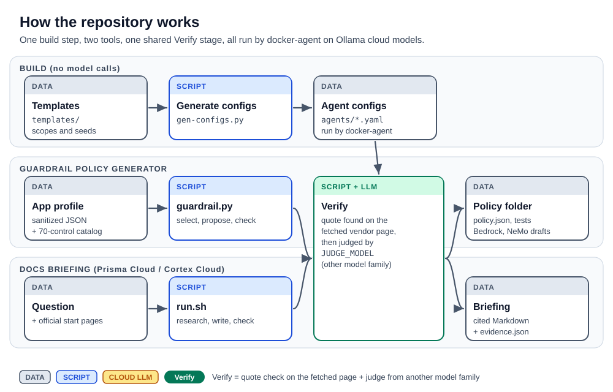

# grounded-ai-guardrails

Advisory AI guardrail policies in which every vendor-backed value is tied to a quote on an official page, plus source-cited Prisma Cloud / Cortex Cloud briefings. Runs on [docker-agent](https://github.com/docker/docker-agent) with Ollama cloud models.

> Independent project; not affiliated with Palo Alto Networks, Docker, NVIDIA, AWS, OWASP or MITRE.



Models only propose. Every value or statement then passes **Verify**: a script finds the quote on the fetched page, and a judge from another model family confirms it supports the claim. Unverified guardrail values stay `catalog-default` (baseline, not vendor-backed).

## Quick start

Needs `bash`, `curl`, `python3` 3.9+, [docker-agent](https://github.com/docker/docker-agent/releases) 1.152+ and [Ollama](https://ollama.com/download) signed in (`ollama signin`). Cloud models only; inputs go to ollama.com, so use sanitized profiles.

```bash
git clone https://github.com/arifbazli/grounded-ai-guardrails.git && cd grounded-ai-guardrails
cp .env.example .env
python3 scripts/guardrail.py --no-llm bench/guardrail/rag-chatbot.profile.json   # no model calls
python3 scripts/guardrail.py bench/guardrail/rag-chatbot.profile.json            # guardrail policy
scripts/run.sh "Why migrate from Prisma Cloud to Cortex Cloud?"                  # docs briefing
```

Results land in `outputs/`: `policy.json`, `tests.jsonl`, `exceptions.md`, `evidence.json`, Bedrock and NeMo drafts, or a cited briefing.

## More

[Guardrail generator](docs/guardrail-generator.md) · [Docs briefing](docs/docs-briefing.md) · [Settings](docs/settings.md) · [Architecture](docs/architecture.md)

Development: edit `templates/`, `seeds/` or `schemas/` (never `agents/*.yaml` or `docs/images/*.svg`), then run `python3 scripts/gen-configs.py`, `python3 scripts/make-diagrams.py`, `python3 -m unittest discover -s tests` and `bench/guardrail/check-golden.sh`.

## License

[MIT](LICENSE)
