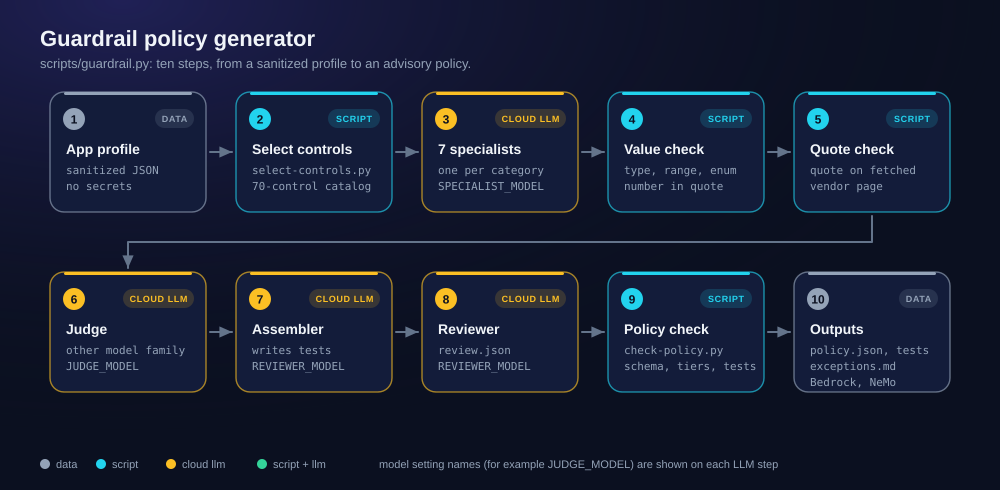
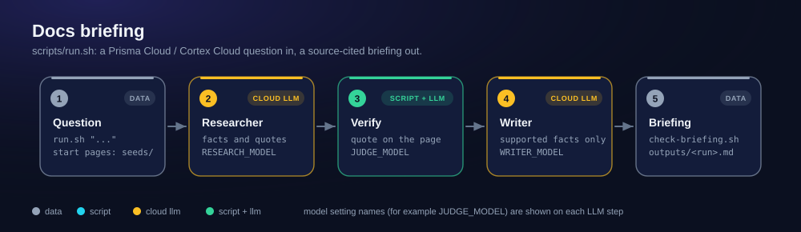

# Architecture

Back to the [README](../README.md). Step details: [guardrail-generator.md](guardrail-generator.md) and [docs-briefing.md](docs-briefing.md).

Both tools share the same conventions: Ollama cloud models only, standard-library
Python, source pages fetched by scripts, JSON data files, generated agent configs.
The diagrams are generated by `scripts/make-diagrams.py`; do not edit the SVG files by hand.

## Guardrail policy generator

| Cloud LLM step | Model setting |
|---|---|
| 7 specialists | `SPECIALIST_MODEL` |
| Judge | `JUDGE_MODEL` |
| Assembler and reviewer | `REVIEWER_MODEL` |

## Docs briefing

| Cloud LLM step | Model setting |
|---|---|
| Researcher | `RESEARCH_MODEL` |
| Judge | `JUDGE_MODEL` |
| Writer | `WRITER_MODEL` |

`MODE=agent` replaces the scripted steps with a root agent on `ROUTER_MODEL` inside
docker-agent.
